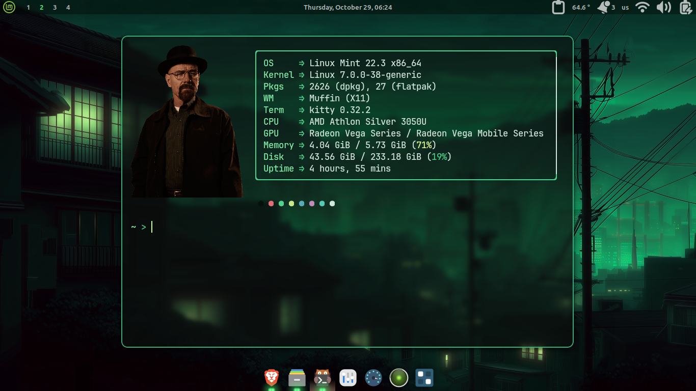
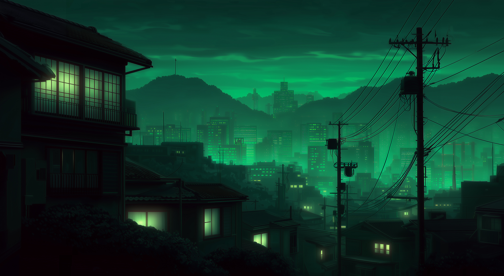

# Green City Kitty

A compact, transparent green terminal setup for **Kitty + Zsh + Fastfetch**.
It uses an 85 × 25 window, a minimal `~ >` prompt, and a boxed system fetch
with a PNG logo.



> The screenshot shows the **optional green window frame** and the bundled
> sample logo. The base install is borderless. See
> [Optional green border](#optional-green-border) for the two files and one
> include line it needs.

## Highlights

- Kitty window with no title bar, 68% background opacity, and an 85 × 25
  default size.
- Green City palette derived from the included wallpaper.
- Minimal `~ >` Zsh prompt, with no username, hostname, or right prompt.
- Fastfetch box designed to fit 85 columns without wrapping.
- PNG logo drawn through Kitty's `kitty-direct` protocol. No ImageMagick or
  `chafa` required.
- Four JetBrainsMono Nerd Font weights included.
- Optional 1 px green outer frame plus native borders between split panes.
- Installer backs up the files it replaces before writing.

## Preview

<table>
  <tr>
    <td align="center" valign="top">
      <br>
      <sub>Included wallpaper</sub>
    </td>
    <td align="center" valign="top">
      <br>
      <sub><code>current.png</code> (sample logo)</sub>
    </td>
  </tr>
</table>

The actual files are `home/Pictures/1-glowing-city.jpg` and
`home/.config/fastfetch/images/current.png`. The copies in `assets/` are there
so GitHub renders them in this README.

The logo is a sample image. Replace it with your own portrait PNG; the steps
are in [Change the Fastfetch logo](#change-the-fastfetch-logo).

## Requirements

- Linux. Tested on **Linux Mint 22.3 Cinnamon (X11)** with Kitty 0.32.2,
  Zsh 5.9, and Fastfetch 2.70.0.
- [Kitty](https://sw.kovidgoyal.net/kitty/)
- [Zsh](https://www.zsh.org/)
- `fontconfig` (for `fc-cache`)
- Fastfetch **2.70.0 or newer**. A 2.70.0 x86_64 binary is included.
- Optional: **Cinnamon + Blur Cinnamon** for real background blur. Kitty's
  own `background_blur` is not honored on Cinnamon.
- No ImageMagick or `chafa` is needed for the logo.

## Quick start

```sh
git clone https://github.com/KaissarSosuke/my-terminal-configuration.git
cd my-terminal-configuration
chmod +x install.sh

# Run as your normal user, not with sudo.
# Exact screenshot look: border, wallpaper, and the Zsh config.
./install.sh --with-zshrc --border --wallpaper

kitty
```

The installer backs up existing files to
`~/.config-backup/green-city-<timestamp>/` before replacing them.

### Installer options

| Option | Effect |
| --- | --- |
| *(none)* | Installs Kitty, Fastfetch, and the font. Leaves `~/.zshrc` alone and installs the shell config as `~/.zshrc-green-city`. |
| `--with-zshrc` | Backs up and replaces `~/.zshrc` with the included Green City config. |
| `--border` | Installs the optional green outer frame and native split borders. |
| `--wallpaper` | Copies `1-glowing-city.jpg` to `~/Pictures/`. |
| `-h`, `--help` | Shows the installer help. |

If you do **not** use `--with-zshrc`, add this line to your existing
`~/.zshrc` to activate the prompt and aliases:

```zsh
source ~/.zshrc-green-city
```

The included config starts Fastfetch on every new shell:

```zsh
command -v fastfetch >/dev/null && fastfetch
```

Remove or comment that line if you only want to run `fastfetch` manually.

## Manual install

If you prefer not to run the installer:

```sh
mkdir -p ~/.config/kitty ~/.config/fastfetch \
         ~/.local/bin ~/.local/share/fonts

cp -a home/.config/kitty/. ~/.config/kitty/
cp -a home/.config/fastfetch/. ~/.config/fastfetch/
cp -a home/.local/bin/fastfetch ~/.local/bin/
chmod +x ~/.local/bin/fastfetch
cp -a home/.local/share/fonts/JetBrainsMonoNerdFont/. \
      ~/.local/share/fonts/JetBrainsMonoNerdFont/

fc-cache -f ~/.local/share/fonts
```

For the shell config, back up `~/.zshrc` first:

```sh
cp ~/.zshrc ~/.zshrc.bak
cp home/.zshrc-green-city ~/.zshrc
```

Start Kitty with `kitty`. The config launches `/usr/bin/zsh` directly, so the
system login shell does not need to change. If your Zsh is elsewhere, update
`shell /usr/bin/zsh` in `~/.config/kitty/kitty.conf`.

## Optional green border

The screenshot at the top uses this option. It requires **two files and one
include line**:

1. `optional/border/green-frame.png` → `~/.config/kitty/green-frame.png`
2. `optional/border/kitty-border.conf` →
   `~/.config/kitty/green-city-border.conf`
3. Add `include green-city-border.conf` to the end of
   `~/.config/kitty/kitty.conf`

The installer can do all three:

```sh
./install.sh --border
```

The installer also refreshes the base configs. If you have local edits, use the
manual steps instead.

Or do it manually:

```sh
cp optional/border/green-frame.png ~/.config/kitty/
cp optional/border/kitty-border.conf \
   ~/.config/kitty/green-city-border.conf
printf '\ninclude green-city-border.conf\n' \
  >> ~/.config/kitty/kitty.conf
```

Fully restart Kitty after adding the include.

### What the border files do

| Setting | Purpose |
| --- | --- |
| `background_image ~/.config/kitty/green-frame.png` | Draws the outer frame around a single window. The PNG is transparent in the middle and has a 6 px `#4FD18F` edge, so it does not tint the terminal. |
| `background_image_layout scaled` | Scales the frame to the current window size. |
| `background_tint 0` | Keeps the frame from tinting the terminal background. |
| `window_border_width 1pt` | Draws native borders between split panes. Kitty does not draw this border around a lone window, which is why the PNG is also needed. |
| `active_border_color #4FD18F` | Green border for the focused split. |
| `inactive_border_color #2F6B4F` | Darker green border for inactive splits. |

The base `kitty.conf` has `window_border_width 0` and no frame image, so the
terminal is borderless by default. To go back to borderless, remove the
include line and restart Kitty, or rerun the installer without `--border`
(which backs up the current config first).

To change the **outer frame color**, edit `green-frame.png` in an image
editor and replace the `#4FD18F` pixels. Keep the middle transparent. To
change only the **split borders**, edit the two border colors in
`~/.config/kitty/green-city-border.conf`.

## Optional background blur

On Cinnamon, Kitty's `background_blur` does not blur the desktop behind the
window. The real blur in the screenshot comes from the **Blur Cinnamon**
extension.

1. Install **Blur Cinnamon** (`BlurCinnamon@klangman`) from Cinnamon Spices.
2. Open the extension's settings.
3. Enable **Application windows**.
4. Add `kitty.desktop` to the window list with:
   - Enabled: on
   - Custom / override: on
   - Opacity: `0`
   - Blur type: **Dual Kawase**
   - Radius: `10`
   - Saturation: `100`
   - Window opacity: `100`

The extension's own JSON config is not included here, because copying it
would overwrite the recipient's desktop settings. Transparency works without
the extension; only the blur behind the window is missing.

## Optional wallpaper

The full wallpaper is included at `home/Pictures/1-glowing-city.jpg` and
previewed above. Copy it with:

```sh
./install.sh --wallpaper
```

Then set it from **System Settings → Backgrounds**, or on Cinnamon:

```sh
gsettings set org.cinnamon.desktop.background picture-uri \
  "file://$HOME/Pictures/1-glowing-city.jpg"
gsettings set org.cinnamon.desktop.background picture-options 'zoom'
```

Other desktops use their own background settings.

## Customize

### Colors

| What | File |
| --- | --- |
| ANSI palette, foreground, cursor, selection, tabs, URL | `~/.config/kitty/themes/green-city.conf` |
| Terminal background and opacity | `~/.config/kitty/kitty.conf` (`background`, `background_opacity`) |
| Prompt colors | `~/.zshrc` or `~/.zshrc-green-city` |
| Fastfetch box and key colors | `~/.config/fastfetch/config.jsonc` |
| Border colors | `~/.config/kitty/green-city-border.conf` (optional border only) |

The prompt is:

```zsh
PROMPT='%F{#8bf0ad}%~%f %F{#4FD18F}>%f '
RPROMPT=''
PROMPT2='%F{#4FD18F}>%f '
```

`#8bf0ad` is the directory color and `#4FD18F` is the arrow. In
`config.jsonc`, `#4FD18F` is used for borders and arrows, and `#8BF0AD` for
the keys (OS, Kernel, CPU, etc.). The palette dots use the terminal's ANSI
colors, so they follow `green-city.conf`.

### Change the Fastfetch logo

Replace the image, then run `fastfetch`:

```sh
cp /path/to/your-image.png ~/.config/fastfetch/images/current.png
fastfetch
```

A portrait PNG with a transparent background works best. The config uses:

```jsonc
"type": "kitty-direct",
"source": "~/.config/fastfetch/images/current.png",
"width": 22,
"height": 13
```

If `current.png` is missing, Fastfetch falls back to its built-in logo. The
included `default.png` is a placeholder you can restore:

```sh
cp ~/.config/fastfetch/images/default.png \
   ~/.config/fastfetch/images/current.png
```

### Window size

The layout is built for 85 columns. Edit `~/.config/kitty/kitty.conf`:

```conf
remember_window_size   no
initial_window_width   85c
initial_window_height  25c
font_size              13.0
```

A narrower window may clip the Fastfetch box.

## File layout

```text
my-terminal-configuration/
├── README.md
├── LICENSE
├── THIRD-PARTY.md
├── install.sh
├── .gitignore
├── .gitattributes
├── assets/
│   ├── screenshot.png
│   ├── fastfetch-logo.png
│   └── wallpaper.jpg
├── optional/
│   └── border/
│       ├── README.md
│       ├── green-frame.png
│       └── kitty-border.conf
├── licenses/
│   ├── fastfetch-MIT.txt
│   └── JetBrainsMono-OFL.txt
└── home/
    ├── .config/
    │   ├── fastfetch/
    │   │   ├── config.jsonc
    │   │   └── images/
    │   │       ├── current.png
    │   │       ├── default.png
    │   │       └── README.md
    │   └── kitty/
    │       ├── kitty.conf
    │       ├── current-theme.conf
    │       └── themes/
    │           └── green-city.conf
    ├── .local/
    │   ├── bin/
    │   │   └── fastfetch
    │   └── share/
    │       └── fonts/
    │           └── JetBrainsMonoNerdFont/
    ├── .zshrc-green-city
    └── Pictures/
        └── 1-glowing-city.jpg
```

## Repository

The project is published at:

<https://github.com/KaissarSosuke/my-terminal-configuration>

The local folder is already a git repository, and `origin` points to that
URL. To push future changes:

```sh
git add .
git commit -m "Update Green City Kitty"
git push origin main
```

All files are well below GitHub's 100 MB per-file limit, so Git LFS is not
needed.

## Troubleshooting

### Kitty reports config errors

Start Kitty with the config explicitly:

```sh
kitty -c ~/.config/kitty/kitty.conf
```

If a setting is invalid, Kitty opens an error window with the file and line
number. Check `~/.config/kitty/kitty.conf` and the optional border include.
Kitty 0.32.2 does not have a separate `--debug-config` flag.

### Font looks wrong

```sh
fc-cache -f ~/.local/share/fonts
fc-match 'JetBrainsMono Nerd Font'
```

Then fully restart Kitty. The config expects:

```conf
font_family JetBrainsMono Nerd Font
```

### Fastfetch is not found

```sh
chmod +x ~/.local/bin/fastfetch
~/.local/bin/fastfetch --version
```

Make sure `~/.local/bin` is in `PATH`. The included `.zshrc-green-city` adds
it automatically.

### Fastfetch logo is missing

Confirm this file exists and is readable:

```text
~/.config/fastfetch/images/current.png
```

If it is missing, restore the placeholder as shown above.

### Border is not visible

- Confirm `~/.config/kitty/green-frame.png` exists.
- Confirm `~/.config/kitty/green-city-border.conf` exists.
- Confirm `kitty.conf` ends with `include green-city-border.conf`.
- Restart Kitty completely; reloading the config is not enough for some
  window-level settings.

### Blur is not working

Enable `kitty.desktop` in Blur Cinnamon as described in
[Optional background blur](#optional-background-blur). The Kitty setting
alone does not produce blur on Cinnamon.

### Zsh does not start

The Kitty config uses `/usr/bin/zsh`. Check where Zsh is installed:

```sh
command -v zsh
```

Update `shell` in `kitty.conf` if the path differs.

## Credits and license

- **Fastfetch** — MIT, <https://github.com/fastfetch-cli/fastfetch>
- **JetBrainsMono Nerd Font** — SIL OFL 1.1, patched from Nerd Fonts v3.5.1
- **Wallpaper** — original source unknown; included as a personal theme asset
- **Sample logo** — replace it with an image you have the rights to use

See [THIRD-PARTY.md](THIRD-PARTY.md) for details and
[`licenses/`](licenses/) for the bundled license texts.

The configuration, scripts, and documentation in this repository are released
under the [MIT License](LICENSE). Third-party assets retain their own
licenses.
